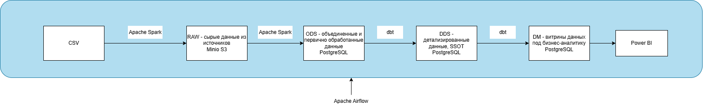

# Contragent_analytic pipeline
Pipeline, который собирает данные о контрагентах и компаниях, обрабатывает их, централизованно хранит и предоставляет аналитикам качественные данные.

# Источники
Данные предоставляются из файлов CSV.

# Технологии
* S3: Minio
* Базы данных: PostgreSQL
* Инструменты обработки и трансформации данных: pySpark, dbt (+ pandas в старой версии)
* Оркестраторы: Apache Aiflow
* Инфраструктура: Docker (S3)

# Схема pipeline

	
	 
	Рис. 1. Архитектура pipeline.
	 

# Как поднять Docker
sudo docker run -d --name minio/lab -p 9000:9000 -p 9090:9090 -e MINIO_ROOT_USER={**USER_NAME**} -e MINIO_ROOT_PASSWORD={**USER_PASSWORD**} minio/minio server /data --console-address ":9090"
